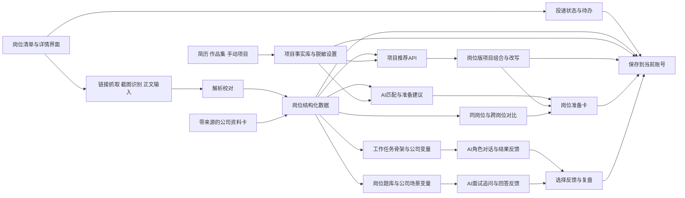

# 岗位探索与求职准备助手 PRD v0.13

更新日期：2026-10-20｜状态：账号、独立页面导航与响应式布局已纳入当前版本

## 1. 产品概述

面向求职过程中难以读懂JD、弄清岗位实际工作或组织个人经历的人，用户可通过岗位链接、截图或正文理解目标岗位与公司业务，并从简历、作品集或手动输入建立个人项目库。产品依据具体JD推荐适合讲述的真实项目、调整表达重点，提供面试练习与对话式岗位体验；用户也可保存岗位、记录投递进展和比较不同机会。

核心使用流程：**提供岗位链接或截图 → 核对JD → 自动了解公司业务与岗位关联 → 准备项目 → 面试或工作任务练习 → 回看复盘与下一步**。投递进展、岗位比较和资料备份可随时使用。


**v0.13新增验收**：登录、注册均只有账号与密码两个输入项；账号只允许字母和数字，重名校验忽略大小写。管理员账号为admin/admin，测试账号为P01—P10、密码123456；示例岗位和项目只保存在管理员账号，普通账号首次登录显示空白工作台，不展示旧浏览器资料的导入提示或入口。同一账号在其他浏览器登录后可以读取已保存的岗位、项目和练习记录，切换账号后看不到上个账号的资料。

首页、岗位清单和岗位详情分别导航与高亮：首页展示当前目标和准备进展，清单展示全部岗位及筛选，详情可切换当前岗位。手机底部固定展示首页、清单、详情、我的项目及“更多”；其余功能从“更多”展开。320—1440像素页面内容可正常换行，表单、筛选和对话框不导致整页横向溢出。

岗位类型随JD自动识别，不设置独立的“岗位归类”页面或批量合并入口。用户可在岗位详情点击“修改岗位类型”，选择职位大类并保存，也可选回“自动识别”。修改只影响当前岗位的类别，保留原始JD、投递进展和自动识别依据，并同步更新清单筛选与分组。

页面标题区只显示大标题和必要操作，不显示口号、英文副标或重复解释。保留岗位、项目等实际资料、输入限制、保存状态和错误提示；岗位分类的理由与原文依据按需展开查看。

**v0.12新增验收**：首次查看尚无研究结果的真实岗位时，自动搜索公司公开资料，显示搜索、读取、分析的进度；已读取的来源先保存。公司业务、岗位关联、可能相关的方向与面试问题均可回看来源，岗位关联能指出对应的JD要求。同名主体无法确认时请用户补充全称或官网。刷新复用已保存结果，更新内容后提示重新研究，支持停止和重试。公司全网搜索需要服务端配置博查或Tavily搜索密钥。

**页面组织**：首页突出继续准备的岗位、可用项目和实际准备进展；岗位工作台按“了解岗位与公司／准备项目／面试准备”切换，只展开当前任务。投递日期、下一步安排与补充资料可按需展开。项目整理后可返回原岗位继续准备，手机提供固定底部导航，键盘可切换准备步骤。

## 2. 相关人员

| 角色 | 当前定位 |
| --- | --- |
| 产品负责人 | 用户本人，负责需求、开发、试用和课堂演示 |
| 目标用户 | 在求职时对岗位职责和能力要求理解不清、觉得JD难懂，或难以选择和组织简历经历的求职者 |
| 课程评审 | 关注真实需求、产品体验、可运行MVP及人机协作过程 |

## 3. 背景与问题

**问题定义**：面对目标岗位，求职者常常难以从JD中判断实际工作内容与关键能力，也不清楚自己的优势和过往经历如何回应岗位需求。公司产品与业务信息分散在不同渠道，查找和理解耗费时间。即使已经积累了项目经历，求职者仍可能不知道该选择哪些经历、如何调整简历表述、面试时重点讲什么；每遇到一个新岗位，都需要重新梳理这些信息。

**产品切入点**：以求职者已有的经历与目标岗位为起点，帮助其理解JD和公司业务、识别可迁移的个人优势，并将项目选择、岗位准备与面试练习组织成可反复使用的求职工作台。

## 4. 目标与验收方式

### 用户目标

用户能回答五个问题：这个岗位实际可能做什么、看重哪些能力；我的经历与要求有哪些对应之处；简历和面试中该选择并怎样讲述项目；还需补充哪些业务信息或能力；通过模拟任务体验后，自己是否希望继续探索这类工作。保存、比较岗位与记录进展帮助用户把准备结果用于后续机会。

### 首版功能验收

1. 用户能通过链接、截图或正文新增JD，核对并修改解析内容；能删除岗位、撤销刚刚的删除，并修改投递状态。
2. 用户能从简历、作品集链接或手动输入建立项目库；选定任意JD后可生成项目组合和表述草稿，并逐条回看项目原始事实。
3. 每条准备建议能回指到JD、简历、项目或公司公开资料；业务线推测显示依据和待确认点。
4. 用户能选择多个岗位，比较共同要求、不同业务场景及各自的准备重点。
5. 用户能完成一段工作任务，经历至少2个决策点、一次角色对话及最终复盘；工作任务材料随所选岗位与公司背景调整。
6. 用户能回答一道与所选岗位相关的面试题，接受一次追问，并获得按评价维度组织的反馈。
7. 在第6天邀请至少2名真实求职者试用，记录他们是否看懂岗位、能否找到适合讲述的经历并形成具体准备行动；第7天修正关键问题并完成演示材料。

课堂验证使用两类岗位、6条真实JD及一份经授权使用的简历；完整展示选择科大讯飞产品经理与vivo人因研究工程师两条样本流程。这些样本用于检查通用流程和呈现效果。

## 5. 用户与使用场景

**目标用户**：在求职过程中对岗位职责不清楚、觉得JD难懂，或难以从已有经历中挑选和组织简历内容的求职者。无论是第一次了解某个岗位、准备一次具体投递，还是比较多个机会，都可以从岗位理解、经历匹配和针对性表达三个环节获得帮助。

| 使用场景 | 用户想完成的事 |
| --- | --- |
| 初次看到一条JD | 看懂职责对应的工作任务、核心要求，以及需要进一步了解的公司业务 |
| 准备简历与面试 | 从已有经历中选出适合该岗位的项目，梳理本人贡献和讲述重点 |
| 比较多个机会 | 找到可复用的准备内容和各岗位需要分别准备的部分 |
| 探索岗位是否适合自己 | 通过模拟面试和工作情境感受该岗位的任务与决策方式 |

课堂演示采用人因工程师和产品经理岗位作为样本，具体JD与项目见文末“演示JD样本”“演示项目样本与组装方向”。

## 6. 产品价值

| 用户需要完成的事 | 产品提供的帮助 |
| --- | --- |
| 快速读懂单条JD | 提取职责、硬性条件、加分项、业务场景和疑问点 |
| 确定准备重点 | 把要求转成可执行的准备清单及优先级 |
| 比较多个机会 | 标出共同能力、公司或岗位特有的业务任务和准备差异 |
| 管理求职准备 | 保存目标岗位、投递状态和可复用的项目与能力，看到各岗位独立的准备任务 |
| 准备个人面试叙事 | 从简历中找出适合重点讲的项目、亮点与需要补充的能力 |
| 按JD组装项目 | 从简历和作品集中选择真实项目，调整排序与表述重点，保留原始事实供核对 |
| 练习岗位面试 | 从岗位题库抽取典型问题，结合目标公司业务调整场景，进行追问与复盘 |
| 感受岗位工作 | 通过对话与工作任务中的任务做判断、看反馈、形成复盘 |

## 7. 方案

### 7.1 用户流程

1. 用户通过链接、截图或正文新增目标岗位，也可选择示例JD体验；导入简历、作品集链接或手动输入项目。
2. 系统展示提取结果，用户确认岗位名称、公司、职责、要求，以及个人项目的角色、做法与结果。
3. 系统依据公司名称与JD自动搜索并读取公开资料，展示公司业务、客户、产品、岗位关联和对应来源；用户可补充公开网页链接或文字。公开信息与可能相关的业务方向分开展示，无法确认的产品线保留为面试问题。
4. 系统生成岗位准备卡与项目组合：工作内容、关键能力、建议重点讲的项目、可替换的表述、能力补充、需要了解的公司信息和待核实问题。
5. 用户在岗位清单中更新投递状态、编辑或删除JD；需要比较时，选择多个岗位查看共同要求、业务差异、可复用项目和分别准备的任务。
6. 用户可进入模拟面试，回答岗位题库中的问题；系统依据目标公司业务调整题目场景，并针对回答继续追问。
7. 用户也可进入工作任务体验，在典型工作日中与虚拟同事对话并作出任务决策。
8. 系统结合面试回答或工作任务选择给出能力复盘和下一步准备建议。

### 7.2 功能范围

| 模块 | 首版功能 | 关键交互与结果 |
| --- | --- | --- |
| JD导入 | 链接抓取、截图识别、正文粘贴三种入口；管理员可使用示例JD；解析结果可编辑 | 三种入口进入同一校对界面 |
| 首页 | 展示当前目标、最近关注、准备进展与计划 | 点击首页或左上角标识可随时返回总览 |
| 岗位详情 | 切换当前岗位，查看JD、公司资料、项目及面试准备 | 查看岗位时独立高亮岗位详情 |
| 岗位清单 | 查看、搜索、筛选、编辑、删除岗位；标记投递状态 | 按岗位方向或状态查看目标岗位及下一步 |
| 岗位解析 | 提取岗位名称、公司、职责、条件、能力、业务线索 | 卡片中展示原文依据；无法确认的内容留作待核实 |
| 公司背景 | 结合可取得的公开资料分析公司产品与业务；用户可补充公开网页链接或文字 | 显示来源链接和采集时间，并由AI提炼与JD相关的业务线索 |
| 简历解析 | 上传DOCX/PDF或粘贴简历文本，提取项目、任务、方法、成果、技能 | 用户可核对和编辑；允许不上传简历体验通用分析 |
| 项目库与项目组装 | 从简历、作品集或手动输入建立项目事实卡；调用大模型按每条JD选择、排序并改写项目表述 | 生成岗位版项目组合；原始事实与改写文本并排可核对 |
| 准备卡 | 根据JD、公司业务和简历生成准备事项 | 推荐重点讲的项目及理由、亮点表述、能力补充、公司信息清单 |
| 岗位对比 | 选择多个JD，比较相近岗位或不同方向 | 展示共同项、产品对象和业务差异、各自适合讲的项目和针对性准备 |
| 求职准备台 | 管理用户关注的目标JD与投递进展 | 展示可复用能力、岗位特有能力、项目讲述策略和待办优先级 |
| 岗位题库与模拟面试 | 根据岗位职责选择核心题型，按公司业务调整场景材料 | 文本作答、AI追问、评价维度反馈和改进提纲 |
| 情境体验 | 根据岗位任务生成或匹配工作任务 | 公司产品背景影响任务；角色对话、后果与复盘形成闭环 |
| 结果保存 | 按账号保存JD、状态、岗位卡、对比和体验结果 | 刷新及其他浏览器登录后保留资料，账号之间相互隔离 |

### 7.3 工作任务体验

用户从岗位详情选择“体验岗位一天”。系统结合JD职责、能力要求和公司公开资料，给出两项前后连贯的日常工作任务：

1. **阅读任务简报**：看清当前问题、已有资料、资源限制和需要交付的内容。
2. **处理第一项任务**：同事直接发来工作消息；用户可先提问，再选择2—3种合理方案之一，或输入自己的推进方式。
3. **继续第二项任务**：保持同一工作目标，补充验证、执行或汇报安排；反馈行动对进度、质量、信息或协作的影响。
4. **回看任务复盘**：把实际提问与选择对应到JD能力要求，形成下一步练习事项。

回应采用日常工作群或需求评审的写法，直接说明信息、诉求和下一步，通常1—3句。不写人物动作、表情、心理活动、场景渲染或戏剧化转折；不靠突然的竞品变化、领导施压或项目被叫停推动任务。信息不足时说明需要向谁确认，不默认用户的方案已经实施或获得成功。公司事实需有公开来源；假设任务和练习数据不能写成该公司的真实事件。

课堂演示选择两个场景：科大讯飞产品经理围绕产品使用问题确定改进优先级；vivo人因研究工程师围绕智能穿戴设备的佩戴舒适性问题设计研究并沟通发现。后者取材于JD提到的产品类别，具体任务为模拟情境。

| 演示线 | 开场任务 | 决策点1 | 决策点2 | 复盘能力 |
| --- | --- | --- | --- | --- |
| 科大讯飞·通用产品经理 | 运营同事发现某功能使用率下降，另有用户提出新需求；产品经理需在有限时间内判断先处理什么 | 先核对数据口径与用户分群，还是直接排期；与运营同事对话获取线索 | 对两项需求排序，向技术团队说明验证方案与取舍 | 需求判断、数据分析、优先级、跨团队沟通 |
| vivo·人因研究工程师 | 智能穿戴设备的佩戴舒适性评价出现分歧，设计团队希望快速得到调整建议 | 在有限样本与时间下选择实验条件、测量方法和参与者 | 面对主观舒适度与客观测量不一致的结果，决定如何复核并向设计团队汇报 | 实验设计、测量解释、情境约束、研究沟通 |

两条任务的事件、人物和数据均作为教学模拟材料呈现。工作任务页保留“岗位依据”入口，用户可查看它与JD哪项职责或要求对应。

### 7.4 岗位题库与模拟面试

**题库结构**：每道题记录岗位方向、题型、考察能力、基础题干、公司场景变量、追问方向、回答评价维度和示例分析。系统根据所选岗位匹配题目，并依据目标公司的公开业务信息调整场景和生成追问。课堂演示使用两道经开发者审阅的基础题。

**人因工程师示例题型：现场实验设计**。vivo演示题给出一个假设场景：智能穿戴设备在长时间使用后出现佩戴舒适性反馈，要求候选人说明研究问题、假设、实验条件、参与者、任务、主客观测量指标、流程、干扰因素和分析思路。其他公司可替换产品类别与约束，仍沿用同一实验设计评价框架。

**反馈方式**：先指出回答覆盖了哪些关键环节，再围绕最影响方案质量的1—2处提出追问，最后生成一份便于用户自行完善的实验设计提纲。评价关注论证完整性、变量与指标的一致性、情境约束和可执行性。

**产品经理示例题型：需求优先级决策**。共用“用户问题—业务目标—约束条件—优先级—验证计划”的能力框架。科大讯飞演示题使用通用产品情境：某功能使用率下降，同时收到两类用户反馈，技术与运营资源有限；候选人需说明如何核查数据、判断问题、排列需求优先级并验证改进效果。题目不预设具体产品线。蔚来可替换为充电产品场景，字节跳动可替换为火山方舟开发者工具场景。

**首版体验**：用户选择岗位后完成一轮“读题—文本作答—1次追问—修改或补充—复盘”。课堂演示在两个示例岗位各展示一轮。后续可增加语音面试与多轮追问。

### 7.5 基础架构



**数据对象**：岗位方向与目标清单、JD原文与链接、公司背景及来源、简历与作品集来源、项目事实卡、脱敏规则、岗位版项目组合与表述版本、岗位信息、准备建议及其依据、同岗位与跨岗位对比结果、面试题与评价维度、用户回答与追问、工作任务节点、角色对话与用户选择。

**实现顺序**：先用已核对的演示JD和公司资料完成单岗位准备卡，导入脱敏简历和作品集的项目事实，再通过项目推荐API生成岗位版组合与改写，接入岗位对比；随后制作两个演示情境，各配一道面试题与一条工作任务。新链接自动读取放在核心流程稳定之后，正文粘贴始终可用。

### 7.6 当前待验证的产品判断

- 岗位差异化准备与工作任务体验作为并行亮点；需要确定演示中二者的时间分配。
- “同岗位”如何定义：岗位名称相同、职能相同，或用户手动指定一组岗位。
- 公司业务线推测如何呈现，才能让用户快速区分公开事实、基于信息的推测和需要面试确认的问题。
- 不同岗位名称但工作内容相近时，系统如何建议分组，并允许用户修正。
- 模拟面试与岗位工作任务是否共用同一组公司背景与能力标签，以保证两种体验给出的反馈一致。

### 7.7 页面结构与导航

采用桌面浏览器优先的单页应用。顶部固定产品名、当前简历和“新增JD”主按钮；左侧为五个导航项：**岗位清单、我的项目、岗位比较、模拟面试、岗位体验**。窄屏时导航收进顶部菜单，内容保持单列可滚动。

| 页面 | 主要内容 | 主要操作 |
| --- | --- | --- |
| 岗位清单 | 按识别或用户指定的岗位方向分组，显示状态统计、岗位卡片、搜索与筛选 | 新增、打开、改状态、比较、删除 |
| 新增JD | 链接、截图、正文三个输入页签；解析进度与校对表单 | 选择文件、识别、修改字段、保存 |
| 我的项目 | 从简历、作品集导入的项目卡；事实、来源、脱敏设置 | 新增、合并重复项、编辑、确认事实 |
| 岗位详情 | JD摘要、原文、公司资料、准备卡、投递进展 | 编辑JD、改状态、进入面试或体验 |
| 项目组装 | 左侧JD要求、中间候选项目、右侧岗位版表述 | 选择与排序、改写、逐条确认、复制 |
| 岗位比较 | 同岗位跨公司、跨岗位方向两个视图 | 勾选岗位、查看共同项与差异、加入准备待办 |
| 模拟面试 | 题目、回答输入区、追问和反馈 | 提交、补充回答、保存复盘 |
| 岗位体验 | 工作任务、角色对话、决策卡片、进展条 | 选择或输入、查看结果、重新体验 |

首次进入展示“新增JD”入口，也可选择示例岗位体验。课堂版本预置六条演示JD并标注“演示样本”；用户新增的岗位进入同一清单。

### 7.8 功能详细需求

#### F01 新增JD与解析（首版必做）

**入口**：岗位清单右上角“新增JD”。弹窗或独立页面提供“粘贴链接”“上传截图”“粘贴正文”三个页签，用户可随时切换输入方式。

| 输入方式 | 操作与反馈 | 异常处理 |
| --- | --- | --- |
| 链接 | 粘贴招聘页面URL，点击“读取并解析”；显示来源域名、读取进度、抓取到的正文预览 | 读取失败或只拿到网页标题时，保留链接并提示上传截图或粘贴正文；用户无需重新开始 |
| 截图 | 拖入、选择或粘贴PNG/JPG/WebP截图；首版每条JD最多3张，按顺序组成一条JD；显示缩略图及识别出的文字 | 文字模糊、截断或顺序错误时，用户可删除单张、调整顺序、补充正文后再次解析 |
| 正文 | 粘贴完整岗位信息，至少填写岗位名称或一段职责文字 | 文本过短时提示补充职责或要求，仍允许保存为草稿 |

三种输入统一进入**校对页**：上方保留原文/图片预览，下方列出公司、岗位名称、岗位方向、招聘类型、地点、岗位职责、任职要求、来源链接。AI先提取草稿并根据JD生成岗位方向标签，用户可逐项修改、自定义方向，再点击“保存岗位”。每条分析结论可展开查看对应的JD原句；未在原文中出现的信息留空。

若来源链接与清单内已有岗位相同，先展示已保存岗位并提供“打开已有岗位”或“仍要新增”。截图仅有部分页面时，卡片显示“待补充”，仍能进入清单。保存后跳转岗位详情并出现“解析完成，可继续补充资料”的提示。

**验收**：链接、截图、正文各能创建一条可编辑JD；链接抓取失败时仍可用截图或正文完成保存；刷新页面后岗位仍在清单中。

#### F02 岗位清单、编辑与删除（首版必做）

岗位卡片固定显示：公司、岗位名称、岗位方向、地点、招聘类型、投递状态、最近更新日期；下方显示最多两条“准备重点”和一条下一步行动。卡片整体可点进详情；更多菜单包含“编辑JD”“删除岗位”。清单默认按最近更新排序，支持按岗位方向、公司和投递状态筛选，并按名称搜索。

点击删除时先显示公司与岗位名称确认框；确认后移出清单，同时出现“已删除，撤销”提示。撤销后恢复该岗位及其准备记录。比较视图中已选择的岗位同步移除；刷新页面后以删除后的清单为准。首版不做批量删除。

**验收**：新增后可在清单找到岗位；编辑后详情与比较视图同步更新；删除及撤销都能正确反映在清单和比较视图。

#### F03 投递状态与下一步（首版必做）

每条岗位只有一个当前状态，用户可从卡片或详情页直接更改：**关注中 → 准备投递 → 已投递 → 笔试/测评 → 面试中 → 已获Offer / 已结束**。这是一组便于筛选的状态选项，用户可直接跳到任意状态。改状态时记录时间；进入“已投递”可填写投递日期，进入“面试中”可填写下一次面试日期，均可跳过；进入“已结束”可选“未通过、主动放弃、岗位关闭”。另有一条用户可编辑的“下一步行动”，例如“补充实验设计案例”或“复习火山方舟产品”。岗位截止日期和个人备注作为后续扩展。

清单顶部显示各状态岗位数，筛选后只显示对应岗位。状态变化不改动JD原文及分析内容；当岗位解析内容被编辑时，准备卡提示“可重新生成”。

**验收**：从卡片改状态后立即更新标签和统计数；刷新页面后保留状态、日期与下一步行动。

#### F04 简历解析与岗位准备卡（首版必做）

用户上传DOCX/PDF或粘贴简历文本，系统提取项目名称、角色、做法、结果、技能，先呈现可编辑的项目列表。用户选择一个岗位后，准备卡按四栏展示：**岗位看重什么、我能讲什么、还需补什么、面试前了解什么**。每项建议含简短理由；推荐项目旁显示对应的JD要求和简历事实。若简历未包含某项要求，显示“可补充的能力或案例”，不把缺失经历写成已有成果。

公司资料以“公开信息＋来源”形式显示。对JD没有明确指定的业务线，单独列出“可能相关的业务方向”和“面试中可确认的问题”。用户可添加一条公开网页链接或文字作为业务背景，并选择用它重新生成建议。

**验收**：同一份简历切换不同JD时，重点项目和准备事项随岗位要求变化；用户能看见每项建议依据的JD和简历内容。课堂演示用已选的公司样本检查这一变化。

#### F05 比较与准备计划（首版必做）

比较页有两个页签。**相近岗位比较**默认按岗位方向筛选，可勾选2—3条JD，生成“共通能力、各公司独有要求、推荐讲述项目、补充知识”四行对照。**跨方向比较**允许选取不同岗位方向的JD，呈现可复用的能力与项目、各自特有要求和准备优先级。

比较结果中的准备事项可点击“加入我的计划”，汇总到岗位清单顶部的“本周准备”区域。每条计划关联具体岗位，可勾选完成；首版只支持手动排序，不生成复杂日程。

**验收**：用户可完成一组相近岗位比较和一组跨方向比较，得到可执行的准备清单。课堂版本用预置的六条JD验证两个视图。

#### F06 模拟面试与岗位工作任务（首版必做）

岗位详情提供两个并列按钮“模拟面试”“体验岗位一天”。模拟面试沿用7.4的岗位核心题，先显示背景、题目和考察能力，用户文本作答后得到一次追问，补充回答后查看分维度反馈。工作任务沿用7.3的两节点结构，每一步展示角色头像/名字、任务信息、2—3个选择及可选的简短输入；用户选择后出现工作后果，再进入下一节点，最后生成复盘卡。两种体验都显示当前所选公司、岗位和业务背景，并允许重新开始。

首版面试与工作任务共用“岗位能力标签”和公司资料卡，使练习结果能回到准备卡的“下一步行动”。课堂版本为两个示例岗位配置可从岗位详情进入的场景，具体内容见7.3与7.4。

**验收**：用户从所选岗位详情进入一轮面试和一段工作任务，每次反馈能指出与该岗位JD相连的能力维度；课堂版本分别用两个示例岗位验证。

#### F07 项目库与岗位版项目组装（首版必做）

**建立项目库**：用户可上传DOCX/PDF简历、输入公开作品集URL，或直接填写一段项目信息。课堂版本预置一份经核对的作品集项目样本；其他网页读取失败时可粘贴项目文字。系统将简历与作品集中的相同项目合并为一张待确认的事实卡，由用户决定保留哪些细节。事实卡字段包括：项目名称、项目类型与阶段、时间、本人角色、问题与目标、具体做法、使用方法或工具、已得到的结果、来源、可公开程度。阶段区分“构思/进行中、原型、已测试、已上线”，由用户确认。

**输入新项目**：在“我的项目”点击“新增项目”，按上述字段填写；允许先写自由文本，再由AI整理为字段。用户可编辑、删除项目，给项目附上链接或文字说明。项目库保留原始事实，针对岗位生成的文案保存在独立版本中。

**按JD组装**：进入岗位详情点击“AI推荐项目”，系统将当前JD要求与用户已确认的项目事实卡提交给项目推荐API。大模型返回项目排序及“直接相关、方法可迁移、需要补充”三类匹配理由，建议一个主讲项目、最多两个辅助项目。用户可替换项目、调整顺序并重新生成表述。右侧生成两种文本：①适合放入简历的简短项目要点；②适合面试回答的“背景—我的行动—结果/当前进展—与岗位的关联”提纲。用户逐条编辑、确认，然后复制文本。示例JD与用户新增JD使用同一调用流程。

**调整表述**：生成时重点改变项目排序、与JD相关的行动细节和行业术语的解释方式。例如，同一研究项目面对不同公司的岗位，可以分别突出研究方法、用户体验指标或跨团队沟通等真实经历，并保留项目原有的行业背景。每条改写旁并排显示“原始事实”和“对应JD要求”，用户点击“采用”后才加入岗位版文本。原始项目卡始终保留。

**脱敏设置**：导入时可选择“仅自己查看”或“生成可展示版本”。可展示版本允许将个人姓名、邮箱、合作方名称、内部产品名、未公开数据、截图中的身份信息替换为通用描述；也可手动遮盖某段文字。替换前展示预览，用户确认后再用于课堂演示或复制。脱敏只改变可识别信息，不改变个人角色、研究方法、项目阶段与实际结果。没有来源支撑的数字或成果标为“待补充”，不自动写入最终文案。

**验收**：用经授权的脱敏简历和作品集建立至少4张项目事实卡；选择不同JD后，真实模型调用返回相应的项目排序与表述重点；新增JD也能使用同一接口；每段最终文本都能追溯原始事实、由用户编辑并保存。课堂演示展示一张“原始项目→岗位要求→改写版本”的对照卡。

### 7.9 视觉风格与交互规范

**整体气质**：简约、清晰、偏职业工具。浅色背景、大块留白、少量蓝色强调；用清晰的信息层级代替装饰性插画。游戏部分沿用同一设计语言，只通过角色对话气泡、场景标题和进度条增加情境感。

| 设计项 | 规范 |
| --- | --- |
| 颜色 | 页面背景`#F7F8FA`；卡片`#FFFFFF`；主文字`#1F2937`；次要文字`#667085`；主色`#315EFB`；边框`#E5E7EB` |
| 状态颜色 | 关注/准备用中性灰与蓝；流程进行中用蓝；Offer用绿色`#17815D`；已结束用灰色。颜色旁始终显示文字状态 |
| 字体与字号 | 优先系统中文无衬线字体；页面标题24px、区块标题18px、正文14—16px、辅助文字12—13px；正文行高约1.6 |
| 布局与间距 | 内容最大宽度约1200px；桌面侧栏约220px；卡片圆角12px；常用间距采用8、16、24、32px四级 |
| 按钮 | 页面只保留一个高亮主操作；次要操作用描边或文字按钮；危险操作放在更多菜单并使用明确确认文案 |
| 图标 | 简单线性图标，配文字标签；不依赖图标单独传达意义 |

**清单交互**：卡片可点击打开，状态为可直接操作的下拉标签；筛选项显示已选数量，并提供“一键清除”。空清单显示“添加第一条JD”及三个输入入口；筛选无结果时提供“清除筛选”。

**解析交互**：输入页保持“原始资料在左、解析字段在右”的双栏；窄屏改为上下排列。解析时显示当前步骤“读取页面/识别文字/提取字段”；完成后将低把握字段标为“请核对”。用户修改字段后，保存按钮始终可见。

**比较交互**：表格横向按公司排列，左侧固定比较维度；每格优先显示短句，点击展开依据和原文。跨岗位视图用“可复用/分别准备”两组内容，避免把不同岗位的要求混在同一评分中。

**项目组装交互**：使用三栏布局，分别放JD要求、项目选择、改写预览；项目卡显示来源和阶段标签。点击某条生成文字时，高亮对应的项目事实与JD要求；未确认的文字显示“待确认”，确认后才能复制整组内容。窄屏改为依次完成“选项目—看改写—确认”三步。

**对话与工作任务交互**：每个场景只突出当前任务、角色发言和本轮可选行动；选项点击后先反馈后果，再出现“继续”。进度以“第1/2个决策”展示。面试反馈按“做得好的点—值得补充的点—建议练习”排列，允许复制回答提纲。

**系统反馈**：保存、状态更新、删除撤销用短提示；读取或AI生成超过数秒时显示加载状态及已完成阶段；失败时说明原因和可继续使用的入口。键盘Tab可依次到达主要控件，输入框与状态按钮有清晰焦点样式。

### 7.10 数据结构与保存规则

每条岗位保存唯一ID、公司、岗位名、岗位方向、招聘类型、地点、来源类型与链接、原始JD文本或截图引用、结构化职责与要求、解析更新时间、投递状态、投递日期、下一次面试日期、下一步行动。每张项目事实卡保存唯一ID、来源、阶段、本人角色、做法、结果、脱敏设置和用户确认状态；岗位版项目文本通过岗位ID与项目ID关联，另存版本与修改时间。分析、比较、面试和工作任务结果与相应岗位ID关联。

资料保存在当前账号，浏览器为各个账号分别保留缓存；截图、简历和项目资料由用户主动选择，在提交AI分析前说明需要将所选内容发送给模型服务。产品提供“清除简历”“删除项目”“删除岗位”入口。若用户后来更改JD或项目事实，已有岗位版文案标记为旧版并可一键重新生成。课堂演示使用用户提供的脱敏简历和经过二次检查的项目可展示版本。

### 7.11 大模型项目推荐API

项目推荐是一项独立服务，前端通过`POST /api/project-recommendations`调用。服务读取当前JD与用户确认过的项目事实，让大模型完成项目排序、匹配解释和岗位版表述；示例项目只用来测试输出，不作为写死的推荐规则。首版默认通过服务端适配器接入ChatECNU，凭据使用服务端环境变量`CHAT_ECNU_API_KEY`，前端只调用本产品的API。

**请求字段**：`job`包含岗位ID、名称、公司、已校对的职责和要求；`projects`包含候选项目ID、脱敏后的事实条目、项目阶段和来源标签；`outputModes`选择`resume_bullets`与`interview_outline`；`maxProjects`首版为3。用户在界面上选择的主讲项目可作为偏好传入，但模型需说明这一选择与JD的关系。

**返回字段**：`recommendations`按顺序列出项目ID、主讲或辅助角色、匹配类型、对应的JD要求ID、所引用的项目事实ID、推荐理由、简历要点和面试提纲；`gaps`列出尚缺少事实支撑的JD要求与建议补充内容；`needsReview`列出需要用户确认的表述。每条生成文字必须附带至少一个已有事实ID。返回中也记录模型生成时间与输入版本，用于岗位或项目修改后的重新生成。

```json
{
  "job": { "id": "job-iflytek-pm", "requirements": [{ "id": "r1", "text": "分析需求并提供解决方案" }] },
  "projects": [{ "id": "P01", "stage": "已上线", "facts": [{ "id": "f1", "text": "整理需求并产出软件原型" }] }],
  "outputModes": ["resume_bullets", "interview_outline"],
  "maxProjects": 3
}
```

响应示例：

```json
{
  "recommendations": [{
    "projectId": "P01",
    "rank": 1,
    "role": "primary",
    "matchType": "direct",
    "requirementIds": ["r1"],
    "factIds": ["f1"],
    "reason": "项目包含需求整理与方案表达经历",
    "resumeBullets": [{ "text": "整理需求并产出软件原型", "factIds": ["f1"] }],
    "interviewOutline": ["问题背景", "本人行动", "结果与进展", "岗位关联"]
  }],
  "gaps": [],
  "needsReview": []
}
```

接口在返回前校验项目ID、要求ID和事实ID是否都存在于本次请求；缺少事实依据的句子进入`needsReview`，不直接放进可复制的最终文案。AI服务不可用时，界面仍保留项目事实卡与用户手动选择、排序和编辑功能，并提示稍后重新生成。项目推荐API与JD解析、面试追问、工作任务对话使用同一个模型服务适配层，便于后续更换模型。

## 8. 版本安排

| 版本 | 范围 |
| --- | --- |
| 7天可演示MVP | 新增JD支持链接、截图、正文；岗位清单可编辑、删除、标记投递状态；导入简历与项目事实，手动补充项目；为目标JD推荐项目、改写简历要点与面试提纲；个人准备卡；相近岗位与跨方向比较；岗位面试题与工作任务；注册登录与账号资料保存 |
| 课堂演示样本 | 预置人因相关岗位和产品经理岗位的6条JD；使用脱敏简历与经核对的项目事实；展示两个岗位的面试题和工作任务，以检验跨公司、跨方向的准备流程 |
| 后续扩展 | 扩充岗位题库与工作任务模板、自动导入任意作品集、完整简历排版与DOCX导出、语音面试、分享与协作 |

### 单人7天制作顺序

| 天数 | 交付物 | 完成判据 |
| --- | --- | --- |
| 第1天 | 页面框架、演示JD与公司资料卡、岗位清单及状态字段 | 可选择公司和岗位、修改投递状态并查看原始JD |
| 第2天 | 链接/截图/正文新增JD、解析校对、编辑与删除 | 三种方式可新增；抓取失败能转截图或正文；可撤销删除 |
| 第3天 | DOCX简历与作品集项目库、事实卡与脱敏设置 | 可导入、校对、补充项目；可预览课堂展示版本 |
| 第4天 | 项目推荐API、岗位版改写、准备卡和岗位比较 | 不同JD触发真实模型调用并返回相应项目组合；能完成相近岗位和跨方向比较 |
| 第5天 | 两道演示面试题、两条工作任务 | 两条演示线都能完成题目与工作任务，并看到反馈 |
| 第6天 | 集成、真实用户试用与修正 | 两名试用者完成核心流程；修复阻断问题 |
| 第7天 | 演示彩排、说明文档与汇报素材 | 从选JD到反馈可连续演示；留存实际制作和修改过程 |

## 演示JD样本

以下岗位与公司资料用于课堂展示通用流程，是演示数据和具体案例。

| 公司与链接 | 已确认的信息 | 后续核对 |
| --- | --- | --- |
| [华为：职位30851](https://career.huawei.com/cn/job-details?advertisementId=30851&lang=zh_CN) | 人因与用户体验工程师（实习生）。用户截图中“人因研究”方向包含实验、用户洞察、软硬件体验评价与体验标准建设；官网当前需选择岗位意向后查看该方向详情 | 具体业务团队及产品对象待核对 |
| [vivo：人因研究工程师实习](https://hr-campus.vivo.com/intern/detail?jobAdId=dc420b3e-a692-49b7-a3b2-069fa4554ab9) | 中央研究院；面向手机、智能穿戴等产品，开展人因研究、用户需求与使用习惯分析，参与前瞻产品规划与定义；要求实验设计、程序开发和统计分析，眼动、脑电或编程经验为加分项 | 具体业务项目待核对 |
| [蔚来：校招人机工程师](https://nio.jobs.feishu.cn/campus/position/7687530409973795098/detail) | 面向整车体验，建立用户感受与工程参数的量化关系；涉及空间、视野、操作、储物等体验评估，虚拟仿真与实车测评，成果沉淀为标准规范；要求统计分析，仿真软件经验为加分项 | 具体车型及项目待核对 |
| [蔚来：校招产品经理](https://nio.jobs.feishu.cn/campus/position/7673027238186862886/detail) | 面向充电产品，包括桩端和能源硬件、充电管理系统与用户体验；涉及需求管理、用户调研、AI能力探索、技术方案评审和数据分析；电力电子知识是重要要求 | 具体产品项目待核对 |
| [字节跳动：AI产品经理（豆包大模型方向）](https://jobs.bytedance.com/campus/position/7667576106895689989/detail?spread=5YNTDRM) | 火山方舟MaaS平台；涉及模型推理、精调工作流、RAG、Tools与Agent开发框架、企业客户落地及效果评估；要求理解LLM技术路径和开发者工具产品 | 具体团队项目待核对 |
| [科大讯飞：产品经理J13399](https://iflytek.zhiye.com/campus/detail?jobAdId=ed343410-6036-4902-b8cf-3b11b8416142) | 集团统一招聘岗位；职责包括发现和分析需求、持续分析产品数据、协调技术与运营推进升级、行业及竞品研究；要求用户需求洞察、商业敏感度、逻辑分析和沟通协作 | JD未指定具体产品线；首版使用通用产品经理场景 |

## 演示项目样本与组装方向

项目事实来自用户提供的脱敏简历和公开[作品集](https://github.com/Eunomio/portfolio)。项目库导入后仍由用户核对本人角色、项目阶段与可展示细节。课堂演示中使用以下候选项目：

| 项目卡（展示用名称） | 可确认的项目要点 | 建议用途 |
| --- | --- | --- |
| P01 专业桌面软件升级项目 | 脱敏简历记载了需求整理、原型设计，以及协调开发和上线工作 | 科大讯飞产品经理的主讲项目：突出需求分析、方案表达与跨团队推进 |
| P02 智能出行人因研究项目 | 脱敏简历和作品集均记载了模拟驾驶实验、自适应交互研究、眼动与行为数据等内容；项目仍在进行中 | vivo人因岗位的研究方法迁移项目；蔚来人机工程师岗位的高相关项目 |
| P03 智能对话体验评价项目 | 脱敏简历和作品集记载了评价框架、对话样本与LLM评估流程 | 人因岗位可突出评价维度设计；AI产品岗位可突出评估流程与结果解释 |
| P04 AI辅助训练产品原型 | 作品集展示了情景复盘、社交模拟、成长记录和报告等产品流程及可运行演示 | 科大讯飞或字节跳动产品经理岗位的辅助项目：突出需求拆解、产品流程与AI原型 |
| P05 健康记录交互设计项目 | 作品集标为交互设计课程小组作业，展示了调研、访谈和多轮界面迭代 | 补充用户洞察和交互设计过程；保持课程项目身份 |

**科大讯飞演示候选组合（已确认）**：P01“专业桌面软件升级项目”为主讲候选，P04“AI辅助训练产品原型”为辅助候选。系统仍按JD和全部项目事实调用大模型排序，并展示推荐理由；用户可采用这组候选或调整。针对JD中的持续监控产品数据要求，系统提示补充真实的数据分析案例或准备方法；相关经历未记录量化成果时，文案保留实际做法并请用户补充可核实结果。

**vivo演示候选组合（已确认）**：P02“智能出行人因研究项目”为主讲候选，P03“智能对话体验评价项目”为辅助候选。系统仍按JD和全部项目事实调用大模型排序，并展示推荐理由；用户可采用这组候选或调整。岗位版文本明确原项目分别发生在汽车与车载对话场景，将方法迁移到智能终端研究；不写成已经做过穿戴设备项目。

| 岗位 | 原始事实摘要 | 岗位版表述示例 | 用户需核对 |
| --- | --- | --- | --- |
| 科大讯飞产品经理 | 在PC端专业软件重构中整理和优化需求、产出原型、协调开发与上线 | “围绕专业软件重构梳理需求并设计原型，协同开发推进功能落地”；面试中按“问题—方案—协作”展开 | 本人实际负责范围、上线结果、能否展示产品细节 |
| vivo人因研究工程师 | 在智能电动汽车研究中设计模拟驾驶实验，采集EEG、眼动、行为和主观数据 | “设计模拟驾驶压力实验并结合多模态数据研究用户状态，为自适应交互方案提供依据”；面试中重点解释变量、测量与分析思路 | 研究阶段、已完成的采集与分析工作、可公开的实验细节 |

### 样本可展示的差异

| 比较视角 | 样本中的直观差异 | 对用户准备的影响 |
| --- | --- | --- |
| 人因方向跨公司 | vivo侧重手机、穿戴与前瞻智能终端；蔚来侧重整车体验与工程参数；华为截图涵盖软硬件体验研究与标准建设 | 同一实验项目可分别突出设计准则、工程参数量化或标准沉淀；需结合本人真实经历选择讲述角度 |
| 产品经理方向跨公司 | 蔚来侧重充电产品与硬件技术；字节跳动侧重企业级大模型平台与开发者工具；科大讯飞JD侧重需求分析、数据监控、产品升级与技术运营协同 | 同一产品项目需分别说明技术约束、目标用户和效果指标；科大讯飞具体业务线需先确认 |
| 人因与产品经理跨岗位 | 三条人因JD强调研究设计、测量与体验评估；三条产品经理JD强调需求规划、跨团队推进和效果优化，产品领域各异 | 可复用用户研究与数据分析经历，同时分别准备实验方案及目标产品的行业知识 |

## 下一轮待确认

1. 课堂演示希望通过本机浏览器运行，还是需要一个可以分享给同学的网页链接？
