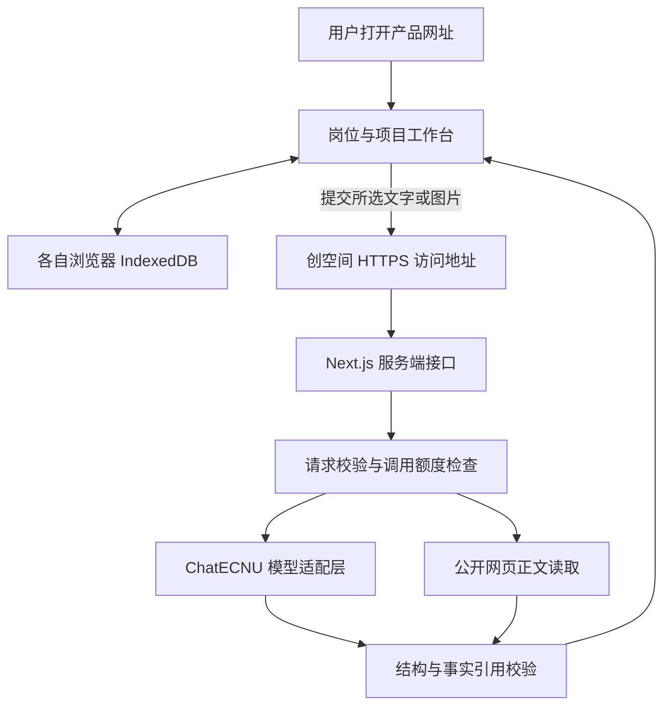

# 岗位探索与求职准备助手网页开发规划

编制日期：2026-10-20。依据：`PRD-岗位探索与求职准备助手.md` v0.12。

产品采用可通过网址访问的网页应用，优先服务中国大陆用户。首版免注册，岗位、项目和准备记录保存在每位用户自己的浏览器。使用 Next.js 和 TypeScript 开发，首轮通过 Docker 部署到 ModelScope 创空间，使用平台提供的网址与免费 CPU 资源。腾讯云服务器作为后续需要自主运维时的备选。

首轮目标是让真实求职者通过网址完成“添加岗位—核对内容—整理项目—生成岗位版表达—练习与复盘”，并在同一浏览器重新打开后继续准备。

本轮优化将自动公司研究加入首版：ChatECNU 负责规划搜索方向和根据来源分析，博查或 Tavily 提供全网搜索。免注册和浏览器保存方式保持一致；搜索密钥只放在服务端。完整发布前需用实际搜索服务验证部署地区的连通性、来源质量与可用额度。

交互按目标岗位组织：导入和校对后打开岗位工作台，在“了解岗位与公司”“准备项目”“面试准备”之间切换；从项目整理页可返回原岗位继续。首页突出继续准备和实际进展。岗位体验改为两项连贯的日常工作任务，同事消息直接说明信息和诉求，结果反馈到工作推进与下一步练习。

## 已确认的产品形态

| 项目 | 开发决定 |
| --- | --- |
| 使用方式 | 用户点击网址即可使用，无需安装软件 |
| 首批用户 | 主要在中国大陆 |
| 设备支持 | 桌面浏览器优先，手机可完成新增、查看和文本练习；项目组装在窄屏分步展示 |
| 账号 | 首版免注册 |
| 保存位置 | 各自浏览器的 IndexedDB，刷新和关闭页面后仍可读取；清除浏览器数据或更换设备后不会自动恢复 |
| 分享含义 | 发送产品网址供他人使用；个人简历、岗位记录与分析结果由各自管理 |
| AI调用 | 网站服务端统一调用 ChatECNU，用户无需填写模型密钥 |
| 数据发送 | 用户提交分析时，所选文本或图片经网站服务器转交模型服务；页面在提交前说明这一点 |

PRD 末尾关于本机运行或分享网址的问题，按本轮确认采用“可分享的网址”。云端同步、个人结果分享和多人协作延续后续版本安排。

## 技术栈

| 层次 | 选择 | 对本产品的作用 |
| --- | --- | --- |
| 页面与服务端 | Next.js App Router、React、TypeScript | 同一项目实现页面、链接读取和 AI 接口，便于单人维护和发布 |
| 运行环境 | Node.js 24 LTS、npm | 本地开发、构建和服务器使用同一主版本，提交依赖锁文件 |
| 界面 | Tailwind CSS、shadcn/ui、Lucide 图标 | 实现 PRD 的卡片、表单、页签、弹窗、三栏组装与窄屏布局；沿用 PRD 配色和字号 |
| 表单与数据校验 | React Hook Form、Zod | 校验用户输入、接口请求、模型返回和本地数据格式 |
| 本地数据 | IndexedDB、Dexie | 保存岗位、项目、图片和练习记录；提供数据结构升级和导入导出 |
| DOCX读取 | Mammoth，使用纯文本提取 | 浏览器提取简历文字后供用户核对，避免直接渲染文档生成的 HTML |
| PDF读取 | PDF.js | 浏览器提取文字型 PDF；扫描件提示选择截图识别或粘贴文字 |
| 截图识别 | ChatECNU 图片理解 | 按顺序处理最多3张JD截图，显示识别文字供用户校对 |
| 网页正文读取 | Node.js fetch、Cheerio | 读取可公开访问的 HTML，提取 JD、公司资料或作品集正文，失败后接续截图或正文输入 |
| 模型调用 | 服务端 fetch、自建轻量适配层 | 统一处理文本、图片、超时、错误和结构化结果，后续可替换服务商 |
| 关键流程验证 | Vitest、Playwright | 检查事实引用、记录保存和核心用户流程 |
| 部署 | Docker、ModelScope 创空间 | 首轮使用平台网址和免费CPU资源，应用监听7860端口；后续可复用镜像迁移到其他服务器 |
| 代码与构建 | GitHub 私有仓库、GitHub Actions | 运行检查并生成带版本标签的镜像，部署同一构建产物 |

选择 Next.js 的主要原因是本产品既需要交互页面，也需要保存密钥、读取网页和调用模型的服务端接口。统一使用 TypeScript，能减少页面与接口之间的数据格式重复维护。Next.js 官方支持 Node.js 和 Docker 部署，后续可继续使用同一代码迁移服务器。[Next.js 部署说明](https://nextjs.org/docs/app/getting-started/deploying)

Node.js 选择当前仍受支持的24 LTS系列；Next.js 与其他依赖在建项时选择兼容的稳定版本，并通过锁文件固定。浏览器存储选择 Dexie 管理 IndexedDB。[Node.js 发布记录](https://nodejs.org/en/about/previous-releases)、[Dexie 文档](https://dexie.org/docs)

### 首版的服务结构

岗位和简历等业务数据不写入云端数据库。服务器持久化少量调用额度与运行记录，供控制成本和排查故障，日志省略简历正文、完整对话和密钥。原始文件优先留在浏览器，所需分析内容按次发送。

暂不增加独立 Python 后端、向量数据库或任务队列。少量 JD 与项目可直接组织为模型输入，剧情使用固定节点和有限对话，先完成可验证的用户流程。

## 模块与实现方式

| 模块 | 首版实现 | 可观察的完成结果 |
| --- | --- | --- |
| 岗位清单与状态 | 岗位增删改查、搜索筛选、状态与日期、下一步行动、删除撤销 | 刷新后记录仍在，删除撤销同时更新清单和比较选择 |
| JD新增与校对 | 正文先打通，随后增加截图与网页链接；三种输入使用同一校对表单 | 用户可查看原文、修改字段、保存岗位；读取失败保留已填内容 |
| 公司背景 | 预置核对过的公司资料，支持补充网页或文字；记录来源和采集时间 | 公开事实、业务推测与待确认问题分别显示，建议可展开依据 |
| 项目事实库 | DOCX、文字型PDF、公开作品集和手动输入；合并候选重复项由用户确认 | 至少4张项目卡可编辑，阶段、本人角色、事实来源和脱敏预览完整 |
| 项目推荐与准备卡 | 模型读取真实JD和已确认事实，返回主讲与辅助项目、改写和能力缺口 | 切换岗位后排序及表述变化，每条采用文本可回看事实和JD要求 |
| 岗位比较与计划 | 每次2—3条JD；相近岗位和跨方向两种视图；准备事项加入本周计划 | 用户能区分可复用准备和各岗位单独准备的内容，并勾选完成 |
| 模拟面试 | 两个岗位方向各一道审阅过的基础题；文本作答、一次追问、补充与复盘 | 完成一轮练习，反馈关联当前岗位的能力要求 |
| 岗位剧情 | 两套任务骨架，各有至少2个决策点和一轮角色对话 | 选择影响后续结果，完成后看到能力复盘和下一步建议 |
| 保存与备份 | IndexedDB、数据版本、JSON导出导入、按类清除记录 | 同一浏览器继续使用；导出文件能恢复到新浏览器 |

JSON备份包含个人资料，导出时明确文件内容。图片和文档读取设置大小与页数上限，接近上限时先压缩图片或提示拆分；具体限制通过首日样本测试确定。

### AI接口与事实依据

保留 PRD 的 `POST /api/project-recommendations` 契约，并按业务拆分其他接口：

| 接口 | 输入与返回 |
| --- | --- |
| `POST /api/sources/extract` | 公开网页URL → 正文、来源URL、采集时间或读取失败原因 |
| `POST /api/jobs/parse` | JD文字或截图 → 原文、字段草稿、职责和要求ID |
| `POST /api/projects/parse` | 简历或项目文字 → 待确认项目事实卡与来源片段 |
| `POST /api/project-recommendations` | JD、已确认事实、选项 → 项目排序、简历要点、面试提纲和事实引用 |
| `POST /api/preparations/generate` | JD、项目事实和公司资料 → 四栏准备卡与来源引用 |
| `POST /api/jobs/compare` | 2—3条JD及相关项目 → 共通要求、差异和准备事项 |
| `POST /api/interviews/respond` | 当前题目、回答和环节 → 一次追问或最终反馈 |
| `POST /api/scenarios/respond` | 剧情模板、当前节点和用户行动 → 角色回应、后果或复盘 |

这些接口共用模型适配层、输入限制和错误格式。先返回完整的结构化结果，再展示可采用文本；对话可以在结果格式稳定后增加逐字显示。

每条职责、要求、项目事实和公司资料均有稳定ID。模型返回后先校验数据结构，再检查引用ID是否属于本次输入；缺失或引用错误的文字列入“待确认”，用户确认后才能复制整组文本。ID存在只能证明引用关系，仍需展示原文供用户核对。项目事实修改或JD更新后，相关生成结果显示“内容已更新，可重新生成”。

ChatECNU 官方文档列出 `ecnu-plus` 和 `ecnu-max`，均支持图片理解。首轮以 `ecnu-plus` 测试响应时间与效果，复杂推荐必要时使用 `ecnu-max`，由真实样本结果决定。使用服务端环境变量 `CHAT_ECNU_API_KEY`、`CHAT_ECNU_BASE_URL`、`CHAT_ECNU_MODEL`；默认地址为 `https://chat.ecnu.edu.cn/open/api/v1`。[ChatECNU 首次调用](https://developer.ecnu.edu.cn/vitepress/llm/index.html)

### 数据组织

首版主要保存 `jobs`、`sources`、`projects`、`projectFacts`、`recommendations`、`preparations`、`comparisons`、`tasks`、`interviewSessions`、`scenarioSessions` 和 `assets`。记录包含唯一ID、创建及修改时间、数据版本；生成结果另存输入版本，原始项目事实与岗位版表达独立保存。

通过统一的数据访问层读写 IndexedDB，页面不直接散落调用数据库。后续需要账号时，可保留现有数据对象，增加用户归属和服务端权限校验，再支持把本地记录迁到云端。

## 开发顺序与时间

沿用 PRD 的单人7天目标，按每天8小时估算，共56小时。安排45小时功能与验证工作，另留11小时处理样本问题、接口失败和修复。此为规划估算，覆盖小范围试用；长期推广所需的大陆备案与持续运营另行安排。

| 时间 | 计划工时 | 开发内容 | 当天验收 |
| --- | --- | --- | --- |
| 第1天 | 6小时 | 初始化项目与界面；定义数据结构和本地保存；放入6条JD样本及公司资料；验证模型文本、图片和JSON返回；准备部署配置 | 可查看岗位、修改状态并刷新保留；样本真实模型调用成功；确认部署节点可访问模型服务 |
| 第2天 | 7小时 | 完成三种JD输入和校对；岗位编辑、删除撤销；公开网页读取及失败接续 | 链接、截图、正文分别走通；打不开的链接可继续用正文保存 |
| 第3天 | 7小时 | 简历与作品集导入；项目事实编辑、合并、阶段确认和脱敏；数据备份 | 授权材料整理出至少4张事实卡；导出后能在另一浏览器导入 |
| 第4天 | 7小时 | 项目推荐接口、岗位版改写、准备卡、比较与本周计划 | 两条不同方向JD给出有事实依据的不同结果；无效引用不会直接出现在采用文本中 |
| 第5天 | 7小时 | 两道面试题、两条剧情；练习结果保存；部署首个完整试用版本 | 科大讯飞和vivo两条样本均能完成面试及剧情；外部网址可使用完整流程 |
| 第6天 | 6小时 | 邀请至少2名真实求职者完成核心任务；检查校园网、家庭宽带和手机网络；修复阻断问题 | 记录用户是否看懂岗位、找到项目、形成下一步；验证不同浏览器记录互不混用 |
| 第7天 | 5小时 | 上线检查、版本发布和回退演练；完整演示彩排；整理试用反馈与使用说明 | 用户从网址独立完成流程；刷新和重开可继续；更新失败可恢复上一版本 |
| 机动时间 | 11小时 | 处理模型格式、PDF读取、网络和集成问题 | 优先保证新增岗位、事实库、推荐与保存可连续使用 |

关键依赖顺序为“数据与证据ID → JD及项目事实 → 项目推荐与准备卡 → 比较及练习”。模型调用和部署连通性在第1天验证，完整试用网址在第5天前准备好，第6天使用线上版本收集反馈。

第1天若发现模型额度、图片能力或结构化输出不满足样本要求，先调整适配器并重新估时。第4天若核心流程仍未通过验收，优先使用机动时间修复；7天后尚未完成的PRD功能单列剩余任务与日期，完成后再对外开放相应入口。

## 发布方式

### 第一轮使用魔搭创空间上线

已验证魔搭账号 `Eunomio` 的令牌有效，并创建私有 Docker 创空间 `Eunomio/JDtool`。当前接口返回的免费配置为 `platform/2v-cpu-8g-mem`，即2核CPU、8GB内存。平台资源与额度可能调整，后续部署前重新查询。

1. 项目代码保存在 `https://github.com/Eunomio/JDtool`，同步必要代码到魔搭创空间仓库。
2. Dockerfile使用Node.js 24构建Next.js，应用监听 `0.0.0.0:7860`。
3. `.env.local` 只留在本地；需要的模型密钥通过创空间Secrets单独配置，镜像不包含本地凭据。
4. 先在私有空间检查页面、接口、浏览器保存和真实模型调用；完成后开放产品访问。
5. 使用平台显示的固定应用地址分享，保持访问来源一致，避免用户浏览器记录被不同网址分开保存。

创空间地址：`https://modelscope.cn/studios/Eunomio/JDtool`。免费资源时长、匿名访问与外部模型服务连通性按账号实际情况验证。[魔搭官方部署说明](https://github.com/modelscope/modelscope-skills/blob/main/skills/ms-studio-deploy/SKILL.md)

### 腾讯云备选发布方式

推荐腾讯云轻量应用服务器香港节点，起步按2核、2GB内存评估，镜像在开发机或CI构建。服务器运行应用和Caddy；根据内存和实际并发测试决定是否增配。

香港节点可省去本轮服务器对应的大陆ICP备案等待，适合先完成试用；线路表现以第6天真实用户网络测试为准。腾讯云说明香港及境外轻量服务器无需进行该项备案。[腾讯云备案资源说明](https://cloud.tencent.cn/document/product/243/18908)

1. 使用独立域名作为用户固定访问地址，设置DNS指向服务器。
2. GitHub保存代码，执行类型检查、针对性测试和生产构建，产出带提交版本的Docker镜像。
3. 服务器配置密钥、额度和运行环境，Compose启动Next.js与Caddy。密钥通过服务器环境配置提供。
4. 域名解析与80、443端口配置完成后，由Caddy申请和续期HTTPS证书；应用端口仅对代理开放。[Caddy 自动HTTPS说明](https://caddyserver.com/docs/automatic-https)
5. 检查首页、真实AI调用、本地保存和网络访问，再发送产品网址邀请试用。
6. 每次更新保留上一镜像版本，检查通过后切换；发现阻断问题可回退镜像。数据结构升级另做向后兼容检查。

首版默认人工触发部署，CI负责检查与构建。先验证镜像仓库到目标服务器的拉取速度；连接不稳定时把同一构建产物传到服务器，避免在小内存服务器上反复安装和构建。

独立域名在第一批用户保存数据前确定。本地数据按浏览器和网址来源隔离，日后更换域名时需引导用户先导出再导入；仅更换服务器并保持域名、协议和端口一致时，可以继续读取已有浏览器记录。

### 后续使用大陆服务器持续推广

若长期服务大陆用户，采用大陆云服务器并按服务商流程完成域名备案，部署同一Docker镜像。腾讯云将大陆与香港、境外服务器的备案要求分开说明。[腾讯云备案资源说明](https://cloud.tencent.cn/document/product/243/18908)

若已有完成备案且可接入的域名和大陆服务器，可直接选大陆节点。备案等待单独计算，购买前以服务商对域名、主体和接入的实际审核要求为准。

### 其他发布方案的取舍

| 方案 | 适用情况 | 本项目的选择依据 |
| --- | --- | --- |
| ModelScope Docker创空间 | 首轮展示与小范围试用 | 当前首选；已验证免费CPU配置，需继续检查运行、访问及额度 |
| 香港服务器与Docker | 希望自主维护运行环境 | 备选；上传、网页读取和模型调用限制可自行配置，需检查大陆实际网络体验 |
| 大陆服务器与Docker | 持续面向大陆用户推广 | 长期优先；部署代码可复用，备案时间需单独安排 |
| Vercel | 海外用户为主，或已验证目标网络可稳定访问 | 可用作替代；文件上传需适配函数请求体限制，且需实测用户和模型服务两端连通性 |

Vercel官方列出的函数请求体和响应体上限为4.5MB，三张截图或简历直接转发时容易触及，因此若采用此方案，需要先压缩、浏览器提取文字或使用对象存储上传流程。当前自托管方案仍会主动设置上传限制。[Vercel Functions 限制](https://vercel.com/docs/functions/limitations)

## 费用与上线准备

开发框架、本地数据库及文档提取工具使用开源方案。首轮使用魔搭账号可用的免费CPU资源和平台网址，暂不购买服务器或域名；AI额度单独核算。后续若改用腾讯云，按每月100—300元预留基础设施预算，域名单独支付；此金额为预算占位，实际以所选地域、套餐和结算页为准。[腾讯云轻量应用服务器](https://cloud.tencent.com/product/lighthouse)

AI费用或校内额度单独核算。第1天测量两条样本完整流程的调用次数、输入输出量和耗时，以“单人完成成本 × 预计试用人数”安排额度；不把校内当前可用额度视为无限供给。

| 需要准备 | 时间 | 用途 |
| --- | --- | --- |
| ChatECNU有效密钥与可用额度 | 第1天 | 验证文本、图片、结构化输出与并发限制；密钥在本地环境或服务器配置，无需写入聊天和仓库 |
| 授权简历、项目材料和6条JD资料 | 第1—3天 | 完成真实样本核对与事实引用检查 |
| 魔搭账号与Docker创空间 | 已创建，部署前继续验证 | 提供首轮试用网址和运行环境 |
| 2名真实求职者 | 第6天 | 在线完成核心流程并反馈 |

公开提供AI接口时按匿名会话和IP限制调用频率，限制输入大小与单次输出，记录全站每日用量并设置停用开关；全站额度记录需在重启后保留。首次额度按试用样本测量结果设置。达到限制时仍允许查看、编辑本地记录。

## 风险与对应处理

| 影响结果的问题 | 处理方式 |
| --- | --- |
| 招聘网站需要登录、拦截抓取或依赖脚本加载 | 先尝试公开HTML；读取失败保留链接，允许截图或正文继续；首版按PRD安排暂缓自动化浏览器抓取 |
| 用户提供的URL指向内网或异常大文件 | 服务端只允许HTTP/HTTPS，检查地址解析与每次重定向，拦截内网地址，限制读取时间和大小 |
| 模型生成不存在的成果或错误引用 | 检查结构与引用ID，展示原始事实，采用前由用户确认；对无依据文本提示补充 |
| 模型服务慢或暂时不可用 | 显示等待与重试入口；保留已输入内容，继续支持手动选项目、编辑及保存 |
| 扫描PDF提取不出文字 | 给出截图识别或粘贴文字入口；避免把空提取结果当作无项目经历 |
| 浏览器清理数据或更换网址 | 提供备份恢复与保存位置说明，保持正式域名稳定 |
| 国内访问香港节点表现不稳定 | 第6天使用不同网络验证；持续影响试用则优先准备大陆部署与备案安排 |
| 多位用户同时调用超出额度 | 设置并发和每日额度，避免重复提交；用真实样本测出可支持的试用规模 |

## 首轮发布验收

1. 他人在自己的设备打开HTTPS网址，可用示例JD体验，也可添加自己的岗位。
2. 链接、截图、正文均可创建可编辑的JD；读取失败后可以换方式继续。
3. 状态修改、删除撤销、项目编辑、本周计划和练习记录在刷新后保持一致。
4. 简历或手动输入可生成待确认项目；科大讯飞与vivo样本触发真实模型调用，返回不同的项目建议和表达重点。
5. 采用文本可查看对应项目事实与JD要求，未获支撑的数字和成果不会直接加入采用内容。
6. 相近岗位和跨方向比较都能形成准备事项；两个样本分别完成一次追问和两节点剧情。
7. 两个浏览器的个人数据分别保存；源码、浏览器请求及页面资源中看不到模型密钥。
8. 导出数据可在新浏览器恢复；AI失败时已编辑的事实与岗位记录仍可查看和保存。
9. 至少2名求职者在线完成核心任务，阻断问题已修复或对应功能暂不开放。
10. 生产构建通过，网页健康检查正常，上一版本可恢复，本地数据升级经过验证。

完成以上验收后，首版即可发送网址供小范围用户持续试用。后续根据实际需求增加账号与云端同步，再扩展任意作品集自动导入、语音面试和个人结果分享。
